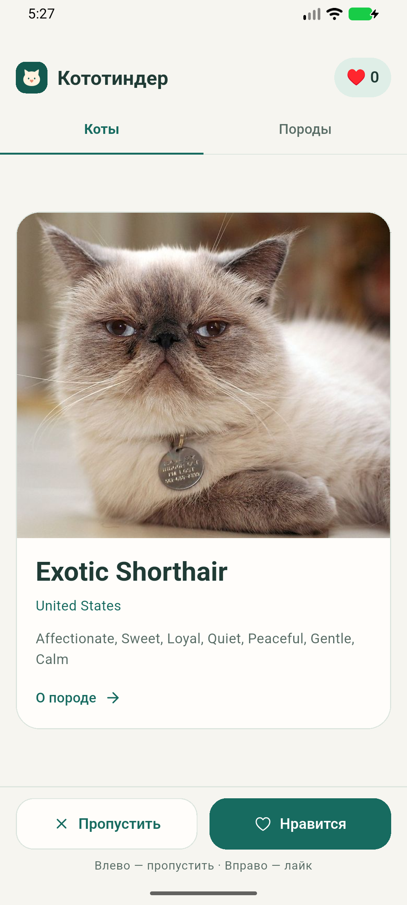
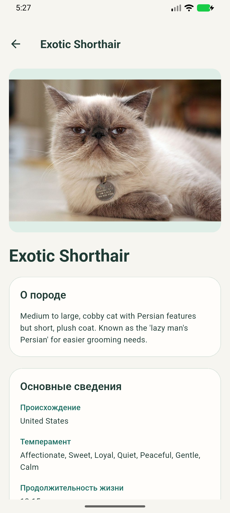
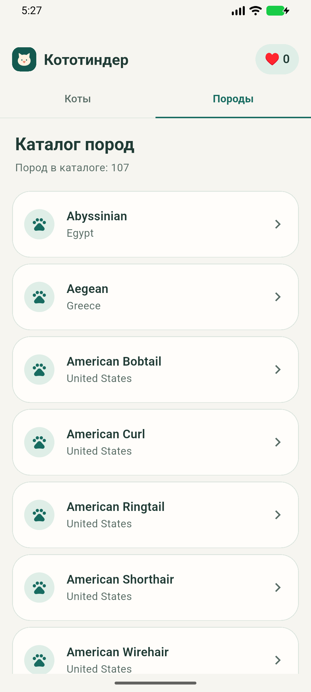
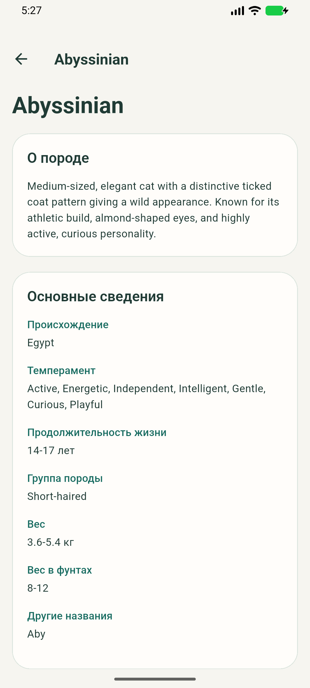
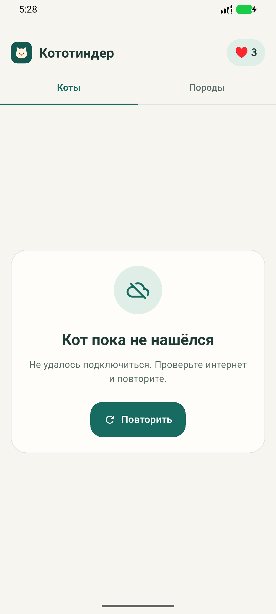

# Кототиндер — HSE_Flutter_HW1

## 1. Описание приложения

Flutter-приложение со случайными котами из TheCatAPI: лента, детали кота,
каталог и детали пород. Версия приложения — **1.0.0**.

## 2. Выполненный функционал

- Настоящие фотографии и сведения API, без демонстрационной подмены данных.
- Лайк/пропуск кнопками и свайпами, счётчик; защита от повторных быстрых действий.
- Детали с тем же котом и фото; Back сохраняет ленту.
- Каталог по алфавиту, подробности породы, сохранение прокрутки и вкладок.
- Локальное сохранение кота и лайков между запусками и Web refresh.
- Загрузка, таймауты, ошибки HTTP/данных/фото/хранилища и безопасный повтор.
- Явная ошибка неверного ключа; инструкция при отсутствии конфигурации.
- Общая тема, своя иконка, прокрутка деталей; закреплённые кнопки доступны
  на узком экране и при увеличенном тексте.
- Типизированные модели, отдельные API/хранилище, параметры через `dart-define`.

## 3. Невыполненный функционал и известные проблемы

В выполненных технических проверках незакрытых дефектов приложения не найдено.
Автор подтвердил исправления R1/R2. Перед сдачей остаются **самостоятельный
раздел 7** и личный приёмочный прогон финального APK.
[Результаты и границы проверок](docs/QUALITY_GATES.md).

Сохранение использует `SharedPreferencesAsync`: данные привязаны к приложению,
а в Web — к origin/профилю браузера. Очистка данных удаляет сохранение. Хранятся
счётчик и модель кота; файлы фото и ключ API не записываются. Сведения API могут
быть неполными: отсутствующие значения не выдумываются. Release APK для ДЗ
подписан локальным development-ключом; публикация в магазин не входит в работу.

## 4. Скриншоты и/или видео

Пять снимков реальной release-сборки `1.0.0` на Android с TheCatAPI:

<p>
  
  
  
  
  
</p>

## 5. APK

[Скачать APK 1.0.0](https://github.com/Ognezvezdd/HSE_Flutter_HW1/releases/download/v1.0.0/cat-tinder-1.0.0.apk)
· [GitHub Release](https://github.com/Ognezvezdd/HSE_Flutter_HW1/releases/tag/v1.0.0)
· [Исходники тега](https://github.com/Ognezvezdd/HSE_Flutter_HW1/tree/v1.0.0).

APK универсальный: `armeabi-v7a`, `arm64-v8a`, `x86_64`.
В Release приложены `SHA256SUMS` и `release.json` с точным commit исходников.
Локальная копия комплекта — `build/releases/v1.0.0/`, исключена из Git.
[Проверка и порядок сдачи](docs/RELEASE.md).

## 6. Запуск и проверки

Проверенное окружение: Flutter **3.47.9**, Dart **3.13.7**, полный **JDK 21**,
Android build-tools 36.1.0; Pixel 8 / Android 17 (API 37). Из корня проекта:

```sh
flutter pub get
cp config.example.json config.json
```

В `config.json` замените маркер своим ключом TheCatAPI. Файл исключён из Git.
Для IDEA добавьте `--dart-define-from-file=config.json` в Additional run args
Flutter-конфигурации; рабочая папка содержит `pubspec.yaml`.

```sh
flutter devices
flutter run -d emulator-5554 --dart-define-from-file=config.json
# Web с постоянным портом для сохранения данных:
flutter run -d chrome --web-port=7357 --dart-define-from-file=config.json
```

ID Android подставляется из `flutter devices`; AVD можно запустить через
`flutter emulators --launch Pixel_8`. Смена ключа/URL требует полного Stop → Run.
`CAT_API_BASE_URL` по умолчанию — `https://api.thecatapi.com/v1`, нужен HTTPS.
Без личного config-файла параметры можно передать непосредственно:

```sh
flutter build apk --release --dart-define=CAT_API_KEY=YOUR_KEY --dart-define=CAT_API_BASE_URL=https://api.thecatapi.com/v1
```

Основные проверки и обычная сборка:

```sh
dart format --output=none --set-exit-if-changed .
flutter analyze
flutter test
flutter build apk --release --dart-define-from-file=config.json
flutter build web --release --dart-define-from-file=config.json
```

В данной версии SDK `flutter analyze` падает при LSP-обмене в пути с кириллицей.
`dart analyze --fatal-infos lib test` работает; также проверен `flutter analyze`
через временную ASCII-символическую ссылку на этот же проект. SDK не изменялся.
JDK должен содержать `javac` и `jlink`; выбранный путь показывает `flutter doctor -v`.

[Ручные и негативные проверки](docs/TESTING.md),
[управляемые Android-проверки HTTPS API](tool/acceptance/README.md),
[карта файлов и путь лайка](docs/ARCHITECTURE.md).
Исходник иконки — `assets/branding/app_icon.svg`; ресурсы уже в Git.
Необязательная перегенерация: `tool/generate_icons.py`, зависимости в
`tool/requirements-icons.txt`; обычная сборка их не требует.

## 7. Устройство приложения — своими словами, без ИИ

**Автору осталось написать здесь самостоятельно 5–10 предложений после разбора
реализации.** Условие требует собственное объяснение; готовый текст от агента
вместо автора не вставлен. Памятка для изучения — [ARCHITECTURE.md](docs/ARCHITECTURE.md).

## 8. Траектория и использование ИИ

Траектория: с агентом Codex. Агент подготовил реализацию, иконку, документацию
и проверки; автор определяет поведение, изучает код и проводит ревью.
[Спецификация](docs/SPEC.md) записана в Git до реализации;
[quality gates и журнал ревью](docs/QUALITY_GATES.md) сохраняют реальные результаты.
Замечания автора R1/R2 исправлены; 24.11.2026 автор подтвердил обе проверки.
Самопроверка агента S1 записана отдельно и не выдаётся за авторское ревью.
